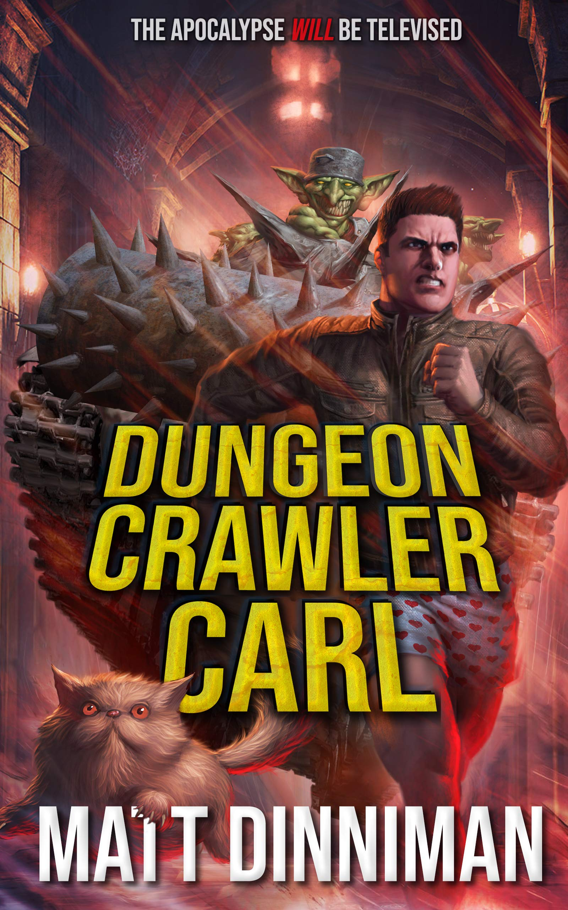

{: width="500" .w-50 .left}
**Dungeon Crawler Carl** is the 1st book in the Dungeon Crawler Carl series. It mixes sci-fi and fantasy with video game mechanics, and it is wildly popular. Here is the Goodreads blurb:

> ***The apocalypse will be televised!***
>
> *A man. His ex-girlfriend's cat. A sadistic game show unlike anything in the universe: a dungeon crawl where survival depends on killing your prey in the most entertaining way possible.*
>
> *In a flash, every human-erected construction on Earth—from Buckingham Palace to the tiniest of sheds—collapses in a heap, sinking into the ground.*
>
> *The buildings and all the people inside have all been atomized and transformed into the dungeon: an 18-level labyrinth filled with traps, monsters, and loot. A dungeon so enormous, it circles the entire globe.*
>
> *Only a few dare venture inside. But once you're in, you can't get out. And what's worse, each level has a time limit. You have but days to find a staircase to the next level down, or it's game over. In this game, it's not about your strength or your dexterity. It's about your followers, your views. Your clout. It's about building an audience and killing those goblins with style.*
>
> ***You can't just survive here. You gotta survive big.***
>
> *You gotta fight with vigor, with excitement. You gotta make them stand up and cheer. And if you do have that "it" factor, you may just find yourself with a following. That's the only way to truly survive in this game—with the help of the loot boxes dropped upon you by the generous benefactors watching from across the galaxy.*
>
> *They call it Dungeon Crawler World. But for Carl, it's anything but a game.*

Read on for my spoiler-free review.

---

## Overall Impression

This one is hard for me to judge. I did enjoy it in the end, but it took me a while to get there. On paper it has everything I should love: Dungeons and Dragons flavor, video game references, and both fantasy and sci-fi elements. The thing is the tone never quite clicked for me. It is gory but lighthearted, and that mix felt a little all over the place.

## Plot

The book is very light and reads fast. You can run through it quickly, though I paused partway, so it took me longer than expected. The structure follows the game, with floors, objectives, and a constant push to simply survive.

My biggest gripe is how brutal and abusive the whole system is. We keep getting reminded that people are dying for no reason other than entertainment. I know that is the point, and it is what drives our protagonist, but it felt distasteful and constant. The only goal is to survive, and the game pushes you to think the only way to win is if everyone else loses. It is surprisingly depressing for what is advertised as a light read. It does get better towards the end as Carl resists in clever ways, but that is only in the last quarter or so, which felt a bit late.

## Characters

Carl is the main character, and he is quite resourceful. His improvisation is one of the best parts of the book, from the bomb crafting to the bike. It seems nothing has gone right in his life (parents, girlfriend, and now the dungeon), but he keeps solving problems creatively and surviving thanks to that.

Princess Donut, the cat, was the more likable character for me. She is sassy, wild, and impulsive, and a bit crazy, but that is part of the fun. Despite her high intelligence stat, Carl still feels like the "smarter" one, which may be a reflection of the hidden wisdom stat the book mentions.

## Setting / World Building

The concept behind this book (and presumably the full series) is interesting. I really liked the behind-the-scenes side of things: the corporation running the game, the intergalactic struggle hinted behind it, and what that implies about the bigger universe. That was what pulled me in most, especially towards the end when we got a few tidbits about it.

The game aspect itself was what I enjoyed least, which is funny given my taste in video games. The mechanics were initially cool, but they got old, and they made me overthink the setup instead of just enjoying it. I think this says something about me: I like games and books where I can fully immerse in the story, and not ones that keep breaking the fourth wall. It reminds me of why I sometimes did not enjoy Hoid's commentaries in [The Fires of December]() - outside commentary like this breaks the immersion for me. Purely personal preference, of course, as I'm sure there are others that feel completely differently about this.

## Final Thoughts

This was still a fun, light read. It is darker and more grim than I expected, but it sets up a clever premise and ends on some interesting cliffhangers that dig further into the corporate, intergalactic side of things. I can see why these books are popular, since they cater to a fast-paced, comical, and violent storytelling style that video game fans will recognize.

I am on the fence about continuing. I will probably pick up the next one at some point, but it will not be a priority. For now I am going back to a reread as I finish Mistborn Era 2 with [The Lost Metal](), and then continuing with **The Expanse** and other more traditional fantasy and science fiction series. If you enjoy gallows humor and game mechanics as a story device, give it a try. If you want deep immersion, you may want to look elsewhere.
